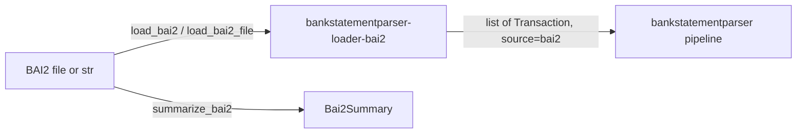

<!-- SPDX-License-Identifier: Apache-2.0 OR MIT -->

<p align="center">
  
</p>

<h1 align="center">bankstatementparser-loader-bai2</h1>

<p align="center">
  BAI2 (Bank Administration Institute, version 2) cash-management loader that parses BAI2 files into bankstatementparser Transaction objects.
</p>

<p align="center">
  <a href="https://github.com/sebastienrousseau/bankstatementparser-loader-bai2/actions"></a>
  <a href="https://pypi.org/project/bankstatementparser-loader-bai2/"></a>
  <a href="https://sebastienrousseau.com/bankstatementparser-loader-bai2/"></a>
  <a href="https://scorecard.dev/viewer/?uri=github.com/sebastienrousseau/bankstatementparser-loader-bai2"></a>
  <a href="LICENSE"></a>
  <a href="https://github.com/sebastienrousseau/bankstatementparser-loader-bai2/blob/main/docs/POLICIES.md"></a>
</p>

<p align="center">
  
</p>

---

## Contents

**Getting started**

- [Install](#install): PyPI, source
- [Requirements](#requirements): toolchain floor, platforms
- [Quick Start](#quick-start): parse a file in three lines

**The bankstatementparser-loader-bai2 ecosystem**

- [The bankstatementparser-loader-bai2 ecosystem](#the-bankstatementparser-loader-bai2-ecosystem): the core library, the other loaders and writers

**Library reference**

- [Capabilities at a glance](#capabilities-at-a-glance): the current surface by theme
- [Ecosystem comparison](#ecosystem-comparison): short matrix; full table at [`docs/COMPARISON.md`](docs/COMPARISON.md)
- [Benchmarks](#benchmarks): headline numbers; full table at [`docs/BENCHMARKS.md`](docs/BENCHMARKS.md)
- [Features](#features): public API, supported records, amounts and signs
- [Configuration](#configuration): core options
- [Examples](#examples): runnable example index

**Operational**

- [When not to use bankstatementparser-loader-bai2](#when-not-to-use-bankstatementparser-loader-bai2): limitations
- [Development](#development): make targets, fuzzing, CI
- [Security](#security): guarantees and compliance
- [Documentation](#documentation): all reference docs
- [Stability guarantees](#stability-guarantees): SemVer axis, output stability, minimum toolchain discipline
- [License](#license)

---

## Install

### As a Python library

```bash
pip install bankstatementparser-loader-bai2
```

That installs the loader and `bankstatementparser >= 0.0.36`, which brings `pandas` and `pydantic`.

| Channel | Command | Notes |
| :--- | :--- | :--- |
| PyPI | `pip install bankstatementparser-loader-bai2` | Pulls in `bankstatementparser >= 0.0.36` |
| Source | `git clone https://github.com/sebastienrousseau/bankstatementparser-loader-bai2 && cd bankstatementparser-loader-bai2 && poetry install` | For development |

Verify the installation:

```sh
python -c "import bankstatementparser_loader_bai2 as b; print(b.__version__)"
# -> 0.0.37
```

An isolated virtual environment keeps the loader's dependencies apart:

```sh
python -m venv venv
source venv/bin/activate        # macOS/Linux
venv\Scripts\activate           # Windows
python -m pip install -U bankstatementparser-loader-bai2
```

---

## Requirements

- **Python 3.10 or later.** CI tests CPython 3.10, 3.11, 3.12, 3.13 and 3.14 on Linux, macOS and Windows; [`docs/POLICIES.md`](docs/POLICIES.md) says when the floor moves.
- **[`bankstatementparser`](https://pypi.org/project/bankstatementparser/) 0.0.36 or later**, whose `Transaction` model and `BankStatementParser` base class the loader produces and extends.
- No network access, native extensions or system packages of its own.

---

## Quick Start

```python
from bankstatementparser_loader_bai2 import load_bai2_file

transactions = load_bai2_file("statement.bai")
for txn in transactions:
    print(txn.account_id, txn.currency, txn.amount, txn.description)
```

Or parse an in-memory payload:

```python
from bankstatementparser_loader_bai2 import load_bai2

payload = (
    "01,SENDER,RECEIVER,260601,1200,FILE001,,,/\n"
    "02,RCVR,ORIG,1,260601,1200,USD,/\n"
    "03,0123456789,USD,010,150000,1,,/\n"
    "16,165,150000,Z,BANKREF1,CUSTREF1,Incoming wire payment/\n"
    "88,from ACME Corp invoice 42/\n"
    "16,475,2500,Z,BANKREF2,,ATM withdrawal/\n"
    "49,152500,2/\n"
    "98,152500,1,4/\n"
    "99,152500,1,6/\n"
)

for txn in load_bai2(payload):
    print(txn.amount, txn.category, txn.description)
# 1500 bai2:165 Incoming wire payment from ACME Corp invoice 42
# -25 bai2:475 ATM withdrawal
```

Both return a flat `list` of `bankstatementparser.transaction_models.Transaction` objects with `source="bai2"`, ready for the rest of a `bankstatementparser` pipeline.

---

## The bankstatementparser-loader-bai2 ecosystem

bankstatementparser-loader-bai2 is one of the input loaders of the `bankstatementparser` suite, whose packages ship one version together. The full table is in [The suite](docs/suite.md).

| Component | Purpose | Use case |
| :--- | :--- | :--- |
| [`bankstatementparser`](https://github.com/sebastienrousseau/bankstatementparser) | The parser core: CAMT, pain.001, CSV, OFX, QFX, MT940, MT942, BAI2 and PDF statements, and the `Transaction` model | Parsing statements from Python or the CLI |
| **`bankstatementparser-loader-bai2`** | This loader: BAI2 text to `Transaction` objects, with `88` continuations, funds-type subfields and a documented sign convention | Loading BAI2 files from US banks |
| Other loaders | MT942, CFONB 120, CAMT.054, SEPA pain.002 / pain.008 and BACS Standard 18 | Formats beyond the core |
| Writers and transport | XLSX, QIF, OFX and SWIFT writers; EBICS retrieval | Exporting transactions and fetching statements |
| [`bankstatementparser-mcp`](https://github.com/sebastienrousseau/bankstatementparser-mcp), [`bankstatementparser-lsp`](https://github.com/sebastienrousseau/bankstatementparser-lsp) | Agent tools and editor diagnostics over the core | AI agents and MT940 editing |



---

## Capabilities at a glance

| Area | Capability | Status |
| :--- | :--- | :--- |
| Loading | `load_bai2` (text) and `load_bai2_file` (path) to `list[Transaction]` | Shipped |
| Summary | `summarize_bai2` to a `Bai2Summary` without building transactions | Shipped |
| Core integration | `Bai2StatementParser`, a `BankStatementParser` registered as the `bai2` entry point in `bankstatementparser.loaders` | Shipped |
| Records | `01`, `02`, `03`, `16`, `88`; `49`/`98`/`99` trailers ignored | Shipped |
| Robustness | CRLF, blank lines, trailing spaces, optional trailing `/`, `V`/`S` funds-type subfields | Shipped |
| Control totals | Validating the `49`/`98`/`99` sums | Not in this loader |

---

## Ecosystem comparison

The core `bankstatementparser` also ships a BAI2 parser (`Bai2Parser`); this loader handles more of the `16` record layout. Every cell comes from the projects' own source code.

| Project | `88` continuations | Commas in `16` text | Funds-type subfields |
| :--- | :---: | :---: | :---: |
| **bankstatementparser-loader-bai2** | Appended to the `16` text | Kept | `V` and `S` |
| `bankstatementparser` `Bai2Parser` | Ignored | Split on | Not handled |
| [`bai2`](https://github.com/ministryofjustice/bai2) (Ministry of Justice) | Merged into the record | Kept | Parsed |

See [`docs/COMPARISON.md`](docs/COMPARISON.md) for the evidence and complete matrix.

---

## Benchmarks

`benches/bench_load_bai2.py` times `load_bai2` and `summarize_bai2` as a file grows along both axes a real bank-day file grows: transactions per account and accounts per file. Cost per transaction stays flat from 10 to 10,000 transactions, and a summary costs about a third of a full load.

| Scenario | Result | Environment |
| :--- | ---: | :--- |
| `load_bai2`, 1 account x 1,000 transactions (66 KiB) | 4.35 ms | Apple M1 Pro, macOS 27.2.1, CPython 3.12.16 |
| `load_bai2`, 50 accounts x 200 transactions (648 KiB) | 46.82 ms | Apple M1 Pro, macOS 27.2.1, CPython 3.12.16 |
| `summarize_bai2`, 50 accounts x 200 transactions (648 KiB) | 12.24 ms | Apple M1 Pro, macOS 27.2.1, CPython 3.12.16 |

See [`docs/BENCHMARKS.md`](docs/BENCHMARKS.md) for methodology and full results.

---

## Features

<!-- --8<-- [start:features] -->

### Public API

```python
from bankstatementparser_loader_bai2 import (
    Bai2StatementParser,
    load_bai2,
    load_bai2_file,
    summarize_bai2,
    Bai2Summary,
)
```

| Class / Function | Signature | Returns |
| :--- | :--- | :--- |
| `Bai2StatementParser` | `Bai2StatementParser(path)` | `BankStatementParser` parser instance |
| `load_bai2` | `load_bai2(text: str)` | `list[Transaction]` |
| `load_bai2_file` | `load_bai2_file(path)` | `list[Transaction]` |
| `summarize_bai2` | `summarize_bai2(text: str)` | `Bai2Summary` |

`Bai2Summary` is a dataclass with the fields `file_id`, `group_count`,
`account_count`, `transaction_count`, and `currency`.

Each produced `Transaction` is populated as follows:

| `Transaction` field | Source |
| :--- | :--- |
| `account_id` | `03` Account Identifier: `accountNumber` |
| `currency` | `03` `currencyCode`, falling back to the `02` group currency |
| `amount` | `16` `amount` (cents / 100), signed per the convention below |
| `booking_date` | `02` Group Header as-of date, when present |
| `description` | `16` text plus any `88` continuations |
| `transaction_id` | `16` `bankRefNum`, falling back to `customerRefNum` |
| `reference` / `category` | The raw `16` type code (`category` as `bai2:<code>`) |
| `source` | Always `"bai2"` |

### Supported BAI2 subset

BAI2 records are comma-delimited fields ending with a `/` delimiter,
each beginning with a numeric type code. This loader implements a
**documented, pragmatic subset**:

| Record | Meaning | Handling |
| :--- | :--- | :--- |
| `01` | File Header | **Required first record.** `fileId` captured for the summary. |
| `02` | Group Header | Group `currency` and as-of date captured. |
| `03` | Account Identifier | `accountNumber` + optional `currencyCode` captured; account currency overrides group currency. |
| `16` | Transaction Detail | One transaction. The free-text field runs to end-of-record (commas included) and is kept verbatim; `V`/`S` funds-type subfields are accounted for when locating the references and text. |
| `88` | Continuation | Appended verbatim (commas included) to the preceding `16` record's text. A `88` continuing an `03` summary, or one with no preceding `16`, is dropped rather than mis-attached. The rare `88:` colon form is tolerated. |
| `49` / `98` / `99` | Account / Group / File trailers | **Ignored**: control totals are not validated. |

Any other (or unknown) leading type code is ignored so that vendor
extensions do not abort the parse. Ignoring control-total trailers is a
deliberate, documented choice: the goal is faithful transaction
extraction, not file-level reconciliation.

### Amount and sign convention

BAI2 amounts are unsigned integers in the account currency's **minor
units** (cents), with no decimal point. They are converted to
`decimal.Decimal` (never `float`) by dividing by 100.
An empty amount field is treated as `0`, and a leading `+` or `-` is
tolerated; any other content (a decimal point, an exponent, letters,
`NaN`) raises `ValueError`.

Debit / credit direction is derived from the documented numeric ranges
of the `16` record's type code (this is the loader's chosen, documented
convention):

| Type-code range | Meaning | Behaviour |
| :--- | :--- | :--- |
| `100`–`399` | Credit | amount kept **positive** |
| `400`–`699` | Debit | amount made **negative** |
| `700`–`799` | Loan detail | treated as a debit-side disbursement: amount made **negative** |
| `900`–`999` | Custom / summary / status | **no `Transaction` emitted**: these non-detail status/summary codes are skipped (and any continuation attached to one is dropped with it) |
| anything else | Unknown (incl. non-numeric) | amount kept **positive** |

The raw BAI2 type code is always preserved on every emitted
`Transaction` in both `category` (as `bai2:<code>`) and `reference`, so
no information is lost.

A small, optional lookup of well-known type codes (for example `142`
"ACH credit", `301` "Commercial deposit", `475` "Check paid", `501`
"Wire transfer debit") enriches the `description` of a `16` record that
carries no free-text of its own; a record that already has text keeps
its own text unchanged.

### Errors

`load_bai2`, `load_bai2_file` and `summarize_bai2` raise `ValueError`
when the payload does not start with an `01` File Header, and the two
loading functions raise `ValueError` for a malformed `16` amount.
Anything else they do not model is skipped rather than guessed at.

<!-- --8<-- [end:features] -->

---

## Configuration

The loader has no options, configuration file or environment variables: the record subset and the sign convention above are fixed, so the same file always loads the same way. Installing the package registers `Bai2StatementParser` under the `bai2` name in the `bankstatementparser.loaders` entry-point group, which is how the core discovers it; nothing needs to be configured for that.

---

## Examples

[`examples/`](examples/) holds three runnable scripts, each run in CI against an inline sample, so no data files are needed:

| Example | Demonstrates |
| :--- | :--- |
| [`01_load_transactions.py`](examples/01_load_transactions.py) | `load_bai2` on a multi-record payload: the sign convention and an `88` continuation |
| [`02_summarize_file.py`](examples/02_summarize_file.py) | `summarize_bai2`, then `load_bai2_file` reading the payload back from disk |
| [`03_full_tour.py`](examples/03_full_tour.py) | Every public symbol against one payload covering `01`/`02`/`03`/`16`/`88`/`49`/`98`/`99` |

```sh
python examples/01_load_transactions.py
```

---

## When not to use bankstatementparser-loader-bai2

- **You have ISO 20022 camt.053 or SWIFT MT940, not BAI2.** Those are different formats with their own parsers in the core and the suite.
- **You need control-total reconciliation.** This loader extracts transactions and deliberately ignores the `49`/`98`/`99` trailers; if you must validate file sums, do so before or after loading.
- **You need the full BAI2 specification.** This is a documented subset focused on transaction extraction, not an exhaustive BAI2 parser, and it does not write BAI2.
- **You need balances.** The `03` summary amounts and status codes are not turned into balance records.

---

## Development

```bash
git clone https://github.com/sebastienrousseau/bankstatementparser-loader-bai2.git
cd bankstatementparser-loader-bai2
poetry install
make check
```

`make check` runs the local gates: `ruff` and `black`, `mypy --strict`, the complexity baseline (`scripts/check_complexity.py`), `pytest` with a 100% line + branch coverage floor, `interrogate` at 100% docstring coverage, and the examples. Other targets: `make fuzz` (Atheris, 60 s, Linux x86_64 with Python 3.12+), `make docs` (the MkDocs manual, `--strict`), `make mutation` (mutmut) and `make demo` (re-renders the GIF above with VHS from `.github/demo.tape`). CI adds the OS by Python matrix, the fuzz run, CodeQL, `pip-audit` on the locked requirements and the Docs Lint gates. Documentation and example regression tests ([`tests/test_docs_accuracy.py`](tests/test_docs_accuracy.py), [`tests/test_regression_docs.py`](tests/test_regression_docs.py), [`tests/test_regression_examples.py`](tests/test_regression_examples.py)) execute every documented snippet and every `examples/*.py` script.

Current state (v0.0.37): 100% line + branch coverage against a 100% enforced floor, `mypy --strict` clean, interrogate 100%, and a mutation-tested loader (455/481 mutants killed; the 26 survivors are documented equivalent mutants, see [`tests/MUTATION.md`](tests/MUTATION.md)). [`CONTRIBUTING.md`](CONTRIBUTING.md) covers branches and commit signing.

---

## Security

- **Read-only.** The loader only reads text and files you pass it; it writes nothing.
- **No XML, no network, no code execution.** Parsing is a pure string-to-dataclass transformation.
- **Decimal arithmetic** is used throughout, avoiding `float` rounding surprises in financial amounts, and a malformed amount is refused rather than guessed at.
- **Fuzzing.** `fuzz/fuzz_load_bai2.py` drives `load_bai2` and `summarize_bai2` with Atheris in CI, seeded with the repository's fixtures, and fails on any exception other than `ValueError` and on any malformed `Transaction`.
- **Supply chain.** Dependencies are locked in `poetry.lock`, CI installs hash-pinned exports of it, and `pip-audit` and CodeQL run on every change. Releases publish to PyPI through OIDC trusted publishing and carry cosign signatures, SLSA provenance and SBOMs; every workflow action is pinned by commit SHA except the SLSA generator, which must be referenced by tag.

Report vulnerabilities according to [`SECURITY.md`](SECURITY.md).

---

## Documentation

- **User manual:** [sebastienrousseau.com/bankstatementparser-loader-bai2](https://sebastienrousseau.com/bankstatementparser-loader-bai2/), built from [`docs/`](docs/) with MkDocs
- **API reference:** [the manual's API page](https://sebastienrousseau.com/bankstatementparser-loader-bai2/api/), generated from the docstrings
- **Developer docs:** [`CONTRIBUTING.md`](CONTRIBUTING.md), [`ARCHITECTURE.md`](ARCHITECTURE.md), [`RELEASING.md`](RELEASING.md)
- **The suite:** [`docs/suite.md`](docs/suite.md), with every `bankstatementparser` package
- **History:** [`ROADMAP.md`](ROADMAP.md), [`CHANGELOG.md`](CHANGELOG.md)
- **Project site:** [bankstatementparser.com](https://bankstatementparser.com)

---

## Stability guarantees

- **Versioning.** Releases stay on the `0.0.x` line and step by exactly `0.0.1`, in lockstep with the rest of the `bankstatementparser` suite. Under SemVer a `0.0.x` release may break anything; this project names each break in the CHANGELOG instead.
- **The breaking axis is the output**: which records produce a `Transaction`, the sign of each amount, and how each `Transaction` field is filled. Changing any of them for a file that loaded before is a breaking change and is called out in the CHANGELOG, even when no Python signature moves.
- **Output stability.** The loader is deterministic: the same payload gives the same transactions in the same order.
- **Python API.** `load_bai2`, `load_bai2_file`, `summarize_bai2`, `Bai2Summary` and `Bai2StatementParser` keep their names and fields; names starting with `_` are internal.
- **Minimum toolchain.** Python 3.10 is the floor; it moves only in a release, for the whole suite at once, with the reason in the CHANGELOG ([`docs/POLICIES.md`](docs/POLICIES.md)).

---

## License

Dual-licensed under [Apache License, Version 2.0](LICENSE-APACHE) or [MIT](LICENSE-MIT), at your option (`SPDX-License-Identifier: Apache-2.0 OR MIT`). Built on the core [`bankstatementparser`](https://github.com/sebastienrousseau/bankstatementparser) library. Any contribution submitted for inclusion in the work shall be dual-licensed as above, without additional terms or conditions.
